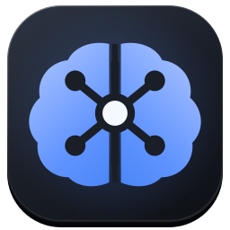

<div align="center">



# Brepsi Brain

**Одна локальная память для всех AI-харнессов: поиск, карточки знаний, MCP-сервер и перенос чата между харнессами и аккаунтами.**

[](https://github.com/AndreyVerse/BrepsiBrain/releases/latest/download/BrepsiBrain.exe)

[](https://github.com/AndreyVerse/BrepsiBrain/releases)
[](https://tauri.app/)
[](https://www.rust-lang.org/)
[](https://www.sqlite.org/fts5.html)
[](LICENSE)

**Портативно · без установщика · без аккаунта · данные остаются на вашем диске**

[English](README.md) · Русский

</div>

---

## ⭐ Зачем нужен Brepsi Brain

Ваши агенты и так пишут на диск всё, что делают: файлы сессий Claude Code, Codex и Kimi Code, плюс история git ваших репозиториев. Brepsi Brain превращает это в единую локальную базу знаний, которой можно задавать вопросы обычным языком, и переносит живой чат в другой харнесс, если работа не закончена.

Сессии Qoder, OpenCode, DeepSeek Harness, Copilot и Antigravity читаются только для переноса чата и не входят в общую индексацию и поиск по памяти.

- **Агенты помнят друг друга.** Без плагинов, хуков и прокси внутри харнесса и без установки в каждый проект. Решение, принятое в Codex в понедельник, находит Claude Code в пятницу.
- **Перенос живого чата в другой харнесс или на другой аккаунт.** Вкладка сразу показывает отдельные списки свежих чатов всех читаемых харнессов — Claude Code, Codex, Kimi Code, Qoder, OpenCode, DeepSeek Harness, Copilot и Antigravity — и сама обновляет их. Выбираете чаты, Brepsi Brain пишет файл передачи (весь чат или выжимку с целью, сделанным и списком оставшегося) и открывает с ним новый чат. Цели: Claude Code, Codex, Kimi Code, Qoder, Antigravity, OpenCode, DeepSeek Harness, ChatGPT, GigaCode и GitHub Copilot, **а ещё любой харнесс, добавленный вами в один клик.** Сценарий **смены аккаунта** сохраняет чат, ждёт, пока вы перезайдёте под другим аккаунтом, замечает смену и продолжает работу там. Пароли и токены он не читает.
- **MCP-сервер в том же exe, который отвечает за 9 мс.** `BrepsiBrain.exe mcp` отдаёт `search_memory`, `recent` и `get_card` по stdio любому MCP-клиенту.
- **Поиск понимает формы русских и английских слов.** BM25 по заголовку, ключевым словам, пересказу, вопросам и атомам, с учётом свежести, один результат на разговор.
- **Данные остаются у вас.** SQLite в `data/`, секреты маскируются до сохранения. Пересказы делает любой OpenAI-совместимый провайдер на ваш выбор, а записи, подходящие под ваши шаблоны приватности, уходят только в локальную модель.
- **Нет платного API? Поставьте локальную модель.** Встроенный установщик скачивает портативный движок и модель под вашу видеокарту (от 8 ГБ видеопамяти, для слабых машин есть модели полегче) и сам всё подключает. Модели назначаются по видам данных, а движок останавливается после простоя и не держит видеопамять весь день.

## 🚀 Запуск

**[Скачать BrepsiBrain.exe](https://github.com/AndreyVerse/BrepsiBrain/releases/latest/download/BrepsiBrain.exe)** — сохранили и запустили · [архив .zip меньше в 2,2 раза](https://github.com/AndreyVerse/BrepsiBrain/releases/latest/download/BrepsiBrain.zip) (его берёт автообновление) · [все релизы](https://github.com/AndreyVerse/BrepsiBrain/releases)

Brepsi Brain — портативный exe: **без установщика, среды выполнения и Python**.

1. Сохраните `BrepsiBrain.exe` в свою папку, например `brepsi-brain\` на любом диске, — или возьмите `.zip` и распакуйте его туда же.
2. Запустите `BrepsiBrain.exe`. Откроется окно, появится значок в трее, а рядом с exe создастся `data\memory.db`.

SHA-256 файла `BrepsiBrain.exe` указан в описании релиза.

> С версии 1.2.0 программа обновляется сама из релизов GitHub: при запуске и после каждой синхронизации проверяет новую версию, сверяет подпись архива, ставит её и перезапускается. Отключается галкой в разделе «О программе». Версию 1.1.0 один раз замените вручную.

```bash
BrepsiBrain.exe          # окно и трей
BrepsiBrain.exe mcp      # MCP-сервер по stdio для харнессов
```

Нужно хранить данные в другом месте (синхронизируемый диск, общая папка)? Укажите корень явно, exe останется на месте:

```powershell
setx BREPSI_BRAIN_ROOT "D:\Knowledge\BrepsiBrain"
BrepsiBrain.exe
```

В корне лежат `config.toml`, `data\` и файлы передачи. Рабочая папка с `data\memory.db` или `config.toml` важнее папки exe, поэтому ярлык может держать данные в одном месте, а программу в другом.

Подключение MCP-сервера в харнессе (`.mcp.json`, `~/.kimi-code/mcp.json` и подобные):

```json
"memory-base": { "command": "D:/Apps/brepsi-brain/BrepsiBrain.exe", "args": ["mcp"] }
```

## 🤝 Свои харнессы

В списке переноса только харнессы, которые реально есть на этом компьютере: их выдаёт папка данных, установленная программа, программа в `PATH` или запущенный процесс. Остальные не мешают. Любой другой добавляется в один клик: **Перенос чата → Куда → «+ Свой»**, укажите имя и при желании программу для запуска. Цель хранится в `data/harnesses.json` рядом с базой, сразу появляется в списке и удаляется так же. Промпт передачи всегда попадает в буфер обмена, поэтому принять его может любое окно чата.

## 🧠 Локальные модели без платного API

Откройте **Модели и оборудование** и нажмите **Установить локальную модель**. Мастер определит видеокарту (NVIDIA через `nvidia-smi`, AMD и Intel через DXGI), порекомендует самую большую подходящую модель, спросит, где её хранить, и скачает:

1. портативный движок Ollama (`v0.40.3`, с проверкой SHA-256) в `<models>/runtime/ollama`;
2. одну модель в `<models>/ollama` — из реестра Ollama или файлом GGUF с Hugging Face, в обоих случаях с проверкой.

На странице видно, что скачано, сколько осталось, скорость и оставшееся время. Прерванные загрузки продолжаются, сбойные источники повторяются с паузой, у движка есть второй источник, а ошибка остаётся на странице с причиной и кнопкой повтора.

На видеокартах AMD Polaris и Vega (Radeon RX 400/500, Vega) работает бэкенд Vulkan. Каждая установка создаёт производную модель `brepsi/<id>` с фиксированным окном контекста. Движок запускается по требованию и по умолчанию останавливается через 120 секунд простоя, `[local_ai] mode = "always"` держит его запущенным.

В `[llm.tasks]` модели назначаются на четыре вида данных: карточки памяти, ответы, выжимки для переноса и названия проектов. **Только локальные модели** направляет всё в локальную модель и не отправляет запросы за пределы компьютера, включить можно ещё до установки модели. Журнал обработки показывает, сколько работала модель в каждой сессии, какие модели использовались и сколько токенов ушло на каждую задачу.

| Видеопамять | Модели |
|---|---|
| CPU или меньше 7 ГБ | Gemma 3 1B, Qwen2.5 1.5B/3B, Gemma 3 4B, Phi-4 Mini |
| 7–10,9 ГБ (RX 580 8 ГБ) | Qwen2.5 7B (рекомендуется), Llama 3.1 8B, варианты с Hugging Face |
| 11–14,9 ГБ | Mistral Nemo 12B, Gemma 3 12B, Qwen2.5 14B |
| От 15 ГБ | Gemma 3 27B, Qwen2.5 32B |

## ✨ Возможности

- **Вопрос к памяти.** Ответ с пронумерованными ссылками `[n]` на ваши записи, уточняющие вопросы продолжают тему.
- **Все записи.** Полнотекстовый поиск с фильтрами по источнику и проекту, карточка на разговор: пересказ, атомы (решения, ошибки, команды, факты), ключевые слова и исходный текст.
- **Карта памяти.** Граф записей, сгруппированных по проектам и связанных общими темами.
- **Проекты и хронология.** Где шла работа и как память растёт от недели к неделе.
- **Журнал обработки.** Очередь пересказов и каждый вызов модели с токенами и стоимостью.
- **Статистика модели.** Часы работы локальной модели за сегодня, неделю и всего, сессии, использованные модели и замер скорости в токенах в секунду.
- **Расписание синхронизации.** Каждые N минут через планировщик Windows или только вручную. Индексация идёт при каждой синхронизации, а у локальной модели свой, более длинный интервал сбора.
- **Актуальные названия проектов.** Сбор данных сам переименовывает проекты локальной моделью (не платным провайдером и не поверх заданного вами имени или сброса), а кнопка запрашивает у модели предложения, которые применяются в один клик.
- **Трей.** Статус синхронизации, свежие карточки, источники, язык, автозапуск, двойной клик открывает окно.
- **Окно** запоминает размер, положение и развёрнутое состояние, при закрытии сворачивается в трей, для пользователя запускается один экземпляр.
- **Русский и английский:** язык следует Windows и переключается в трее или в «О программе».

## 🛠 Сборка

```bash
cargo test --manifest-path core/Cargo.toml          # ядро на Rust: хранилище, поиск, MCP, перенос
node static/smoke.node.mjs                          # смоук-тест панели
cargo build --release --manifest-path app/src-tauri/Cargo.toml
```

Профиль release использует LTO, `opt-level = "s"`, `strip`, одну единицу компиляции и `panic = "abort"`.

## 📄 Лицензия и авторство

Apache License 2.0, см. [LICENSE](LICENSE). Copyright 2026 Andrey Shkenev ([AndreyVerse](https://github.com/AndreyVerse)).

По §4(d) лицензии при любом распространении этой работы или производной от неё **должен сохраняться файл [NOTICE](NOTICE)** с именем автора и ссылками на его профиль и репозиторий.
